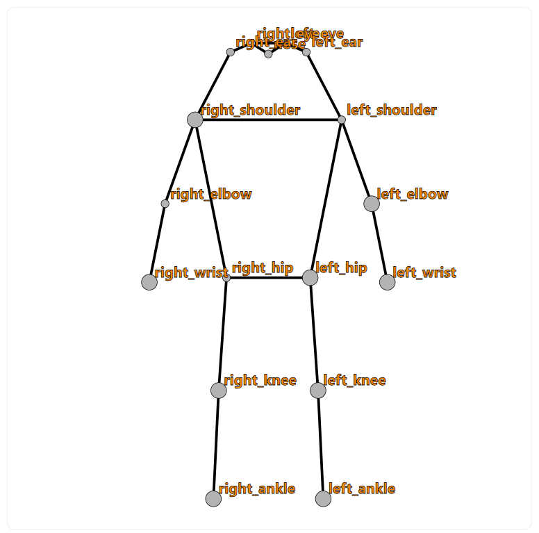
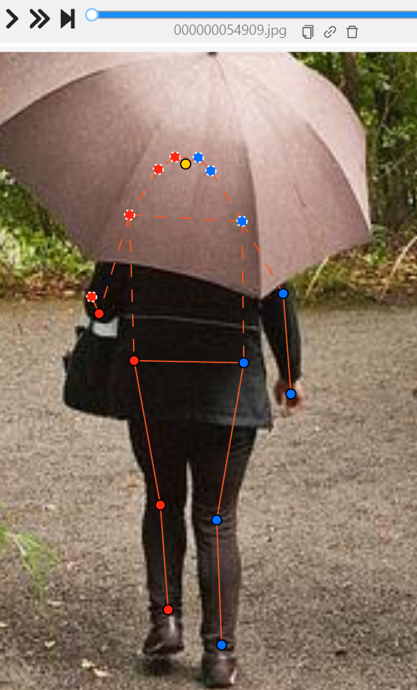
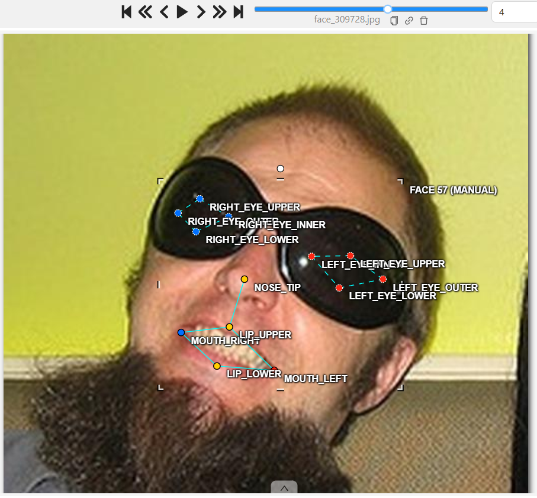
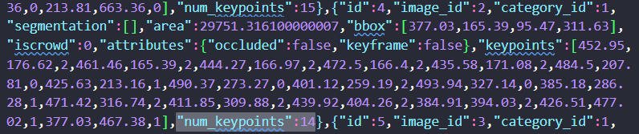

# Báo cáo cá nhân — Nguyễn Thanh Phong — 2A202603119

Dữ liệu: 12 ảnh người và 8 ảnh chân dung cắt từ COCO 2017 (Lin et al., 2014), chỉ dùng trong lớp.

## 0. Thông tin học viên

- Họ tên: Nguyễn Thanh Phong
- MSSV: 202603119
- Email: 26ai.phongnt5@vinuni.edu.vn
- Link repository: https://github.com/Tphong27/K5-L2-DAY04-NguyenThanhPhong-2A202603119-KeypointPose.git
- Phiên bản CVAT: 2.74.1
- Máy: hệ điều hành **Windows** · RAM **16** GB · chế độ CVAT đầy đủ / lite: **đầy đủ**
- Bộ ảnh (`src/exports/assignment.json`): có, đúng 12 ảnh người + 8 ảnh mặt
- Giờ bắt đầu: 16h30 12/11/2026
- Giờ kết thúc: 2h 13/11/2026

## 1. Kiểm tra label (CP0)

| Label    | Kiểu     | Số điểm | Tên điểm đúng bảng của lab? | Đúng thứ tự? | Số cạnh |
| -------- | -------- | ------: | --------------------------- | ------------ | ------: |
| `person` | Skeleton |      17 | Có                          | Có           |      19 |
| `face`   | Skeleton |      13 | Có                          | Có           |      13 |

Mẫu `person` dựng theo người quay mặt về camera, nên các điểm `left_*` nằm bên phải khung mẫu: **Có**.

Cách đổi cờ cho một điểm trên CVAT: rê chuột đúng điểm, bấm `Q` để bật/tắt `occluded` hoặc `O` để bật/tắt `outside`; cũng có thể chuột phải vào điểm và chọn cờ tương ứng.

## 2. Số lượng đã gán và thời gian (CP1, CP2)

Số skeleton dưới đây được đối chiếu từ `assignment.json`, `pool.json` và file export hiện tại.

| Nhóm ảnh        | Số ảnh | Skeleton trong export hiện tại | Số skeleton cần có sau khi sửa | Người dưới 60 px không gán | Poster / gương / màn hình bỏ qua | Thời gian (phút) |
| --------------- | -----: | -----------------------------: | -----------------------------: | -------------------------: | -------------------------------: | ---------------: |
| `easy`          |      5 |                              5 |                              5 |                          2 |                                0 |                  |
| `occluded`      |      3 |                              6 |                              6 |                          0 |                                0 |                  |
| `back`          |      2 |                              4 |                              4 |                          1 |                                0 |                  |
| `small`         |      1 |                              2 |                          **3** |                          0 |                                1 |                  |
| `crowd`         |      1 |                              2 |                              2 |                          0 |                                0 |                  |
| `faces`         |      8 |                              8 |                              8 |                          — |                                0 |                  |
| **Tổng person** | **12** |                         **19** |                         **20** |                      **3** |                            **1** |                  |

Chi tiết đối chiếu theo ảnh:

- `easy`: `137767=1`, `176000=1`, `213933=1`, `292999=1`, `295358=1`.
- `occluded`: `122199=2`, `157271=2`, `393909=2`.
- `back`: `054909=2`, `123544=2`.
- `small`: `150192=2`; cần thêm người ngồi phía sau còn thiếu để thành 3.
- `crowd`: `522889=2`.
- Người dưới 60 px không gán: hai người rất xa trên sườn tuyết trong `176000` và một người ở hậu cảnh sân bóng trong `123544`.
- Màn hình bỏ qua: TV ở hậu cảnh `150192`; đây không phải người thật trong cảnh.

- Số ảnh người đã xong ở mốc phút 105: 6 / 10
- Thời gian thực tế: CP1 **60** phút · CP2 **60** phút · CP3 **45** phút
- Ảnh tốn thời gian nhất và lý do: ảnh 000000122199.jpg. Do người nghiêng chứ không đối diện với camera nên nhiều vị trí trên cơ thể bị che khuất và bị mất.

## 3. Bảng ca khó (CP1, CP2)

| Ảnh            | Người / mặt                     | Điểm                                         |       Cờ đã chọn | Phân vân giữa | Lý do chọn                                                                                                                                                                                                                                                             |
| -------------- | ------------------------------- | -------------------------------------------- | ---------------: | ------------- | ---------------------------------------------------------------------------------------------------------------------------------------------------------------------------------------------------------------------------------------------------------------------- |
| `000000122199` | Người phía trước (#1)           | `left_ankle`, `right_ankle`                  |  `0` (`outside`) | `v=0` / `v=1` | Phần dưới hai cẳng chân đã bị cắt khỏi khung ảnh nên không nhìn thấy cổ chân và cũng không có đủ thông tin để ước lượng chắc chắn; vì vậy tôi chọn `outside` thay vì đặt điểm ở sát mép ảnh.                                                                           |
| `000000122199` | Người phía trước (#1)           | `right_ear`, `right_shoulder`, `right_hip`   | `1` (`occluded`) | `v=1` / `v=2` | Người đứng xoay chéo nên các điểm ở phía xa camera bị đầu, thân người và áo khoác tự che một phần. Tôi vẫn suy ra được vị trí từ đường nối với các khớp lân cận, nên chọn `occluded` thay vì `v=2`.                                                                    |
| `000000122199` | Người phía sau (#2)             | `left_shoulder`, `left_elbow`, `left_wrist`  |  `0` (`outside`) | `v=0` / `v=1` | Toàn bộ tay trái bị ba lô lớn và người phía trước che kín, không còn đoạn chi rõ để lần từ vai đến cổ tay. Vị trí ước lượng có thể dao động lớn nên tôi chọn `outside`.                                                                                                |
| `000000122199` | Người phía sau (#2)             | `right_shoulder`, `right_wrist`, hai `ankle` | `1` (`occluded`) | `v=1` / `v=2` | Các điểm này không nhìn thấy hoàn toàn do quần áo, tư thế và tuyết che một phần, nhưng hướng của cánh tay, cẳng chân và các khớp lân cận vẫn cho phép ước lượng tương đối ổn định; vì vậy tôi chọn `occluded`.                                                         |
| `000000150192` | Người ngồi phía sau đã gán (#1) | `left_hip`, hai `knee`, hai `ankle`          | `1` (`occluded`) | `v=1` / `v=0` | Phần thân dưới bị bàn, ghế và các vật ở tiền cảnh che khuất. Tôi chọn `occluded` vì tư thế ngồi, hướng thân và vị trí ghế vẫn cung cấp căn cứ để ước lượng chuỗi hông–gối–cổ chân; riêng hai cổ chân cần review lại vì bị che rất sâu và có thể phù hợp với `v=0` hơn. |
| `000000150192` | Người phía trước (#2)           | hai `wrist`, hai `hip`                       | `1` (`occluded`) | `v=1` / `v=2` | Hai bàn tay và vùng hông bị cốc, túi giấy và mép bàn che, nhưng cánh tay, khuỷu tay và thân trên vẫn nhìn thấy rõ nên vị trí các khớp có thể được ước lượng từ hình học cơ thể. Tôi chọn `v=1` vì bản thân khớp không nhìn thấy trực tiếp.                             |
| `000000150192` | Người phía trước (#2)           | hai `knee`, hai `ankle`                      |  `0` (`outside`) | `v=0` / `v=1` | Các khớp này nằm phía dưới mép ảnh, hoàn toàn ngoài khung chứ không chỉ bị đồ vật che. Vì vậy tôi đặt `outside`; gán `v=1` sẽ buộc model học từ các tọa độ không có bằng chứng trong ảnh.                                                                              |

## 4. Bảng tự review (CP3)

Tôi review từ ảnh cuối về ảnh đầu, ưu tiên các ảnh có người bắt chéo tay/chân, người quay lưng và nhiều người chồng lấn. Nhìn chung tên trái/phải bám đúng theo cơ thể; các đường xương bắt chéo trong `522889`, `292999` và `123544` là do tư thế thật, không phải hoán đổi điểm. Hai vấn đề cần sửa tập trung ở ảnh `150192`.

| Ảnh            | Người / mặt                     | Điểm                                                   | Mã lỗi     | Ghi chú                                                                                                                                                                                      | Đã sửa?               |
| -------------- | ------------------------------- | ------------------------------------------------------ | ---------- | -------------------------------------------------------------------------------------------------------------------------------------------------------------------------------------------- | --------------------- |
| `000000522889` | Người chơi tennis (#2)          | `left_knee`, `right_knee`, `left_ankle`, `right_ankle` | `ok`       | Chân trái đang co và đưa chéo qua chân trụ nên thứ tự theo trục x khác các cặp ở thân trên. Lần từ từng hông xuống gối và cổ chân cho thấy đây là tư thế thật, không phải `lr_swap`.         | Không cần sửa         |
| `000000292999` | Người đánh bóng chày (#1)       | `left_elbow`, `right_elbow`                            | `ok`       | Hai tay cùng giữ gậy trước ngực nên hai khuỷu tay bắt chéo theo hình chiếu. Vai, khuỷu và cổ tay vẫn nối đúng từng cánh tay; giữ nguyên nhãn.                                                | Không cần sửa         |
| `000000150192` | Người ngồi phía sau bên phải    | Toàn bộ skeleton                                       | `missing`  | Ảnh có hai người ngồi phía sau nhưng hiện mới gán người bên trái. Người còn lại cao hơn ngưỡng 60 px và là người thật trong cảnh nên phải có một skeleton riêng.                             | **Chưa sửa**          |
| `000000150192` | Người ngồi phía sau đã gán (#1) | `left_ankle`, `right_ankle`                            | `vis_flag` | Hai cổ chân bị bàn, ghế và người/vật phía trước che hoàn toàn; không có đoạn cẳng chân đủ rõ để ba người cùng ước lượng gần nhau. Để `v=1` là quá tự tin, nên chuyển sang `outside` (`v=0`). | **Chưa — cần đổi cờ** |
| `000000123544` | Người chạy bên trái (#2)        | `left_knee`, `right_knee`                              | `ok`       | Hai chân giao nhau trong bước chạy nên cặp gối nằm ngược phía so với vai và hông. Lần từ từng hông xuống chân xác nhận tên trái/phải hợp lý; cảnh báo của script là dương tính giả.          | Không cần sửa         |
| `000000054909` | Hai người quay lưng             | Toàn bộ skeleton                                       | `ok`       | Hai skeleton tách đúng từng người; các cặp trái/phải đã đổi theo hướng quay lưng. Các điểm mặt bị ô che được đặt cờ che khuất, còn tay và chân bám đúng đường chi.                           | Không cần sửa         |
| `face_575921`  | Mặt nghiêng                     | 13 điểm mặt                                            | `ok`       | Khóe ngoài của mỗi mắt nằm xa sống mũi hơn khóe trong; mí trên/dưới và hai khóe miệng đúng phía theo người trong ảnh. Không phát hiện đổi trái/phải.                                         | Không cần sửa         |
| `face_309728`  | Mặt đeo kính râm                | 8 điểm mắt                                             | `ok`       | Cả tám điểm mắt nằm sau tròng kính tối và đều được đặt `v=1`; mũi và năm điểm miệng nhìn thấy được đặt `v=2`. Cách đặt cờ phù hợp guideline.                                                 | Không cần sửa         |
| `face_261458`  | Mặt gần chính diện              | 13 điểm mặt                                            | `ok`       | Bốn điểm của mỗi mắt nằm đúng quanh mép mí, `outer/inner` đúng tương quan với sống mũi; chóp mũi và các điểm môi nằm trên đường nét nhìn thấy.                                               | Không cần sửa         |

Tổng hợp số lỗi theo mã:

| `lr_swap` | `vis_flag` | `position` | `missing` | `extra` | `ok` |
| --------: | ---------: | ---------: | --------: | ------: | ---: |
|         0 |          1 |          0 |         1 |       0 |    7 |

Điểm còn phân vân giữa `v = 1` và `v = 0`:

> Tôi phân vân nhất ở hai cổ chân của người ngồi phía sau trong `000000150192`: `v=1` sẽ giữ tọa độ ước lượng để model học, còn `v=0` sẽ bỏ hai điểm khỏi loss. Vì bàn và ghế che kín toàn bộ phần chân, không có đủ dấu hiệu để ước lượng ổn định nên sau khi review tôi chọn `v=0`. Với cánh tay trái bị che kín của người phía sau trong `000000122199`, tôi cũng giữ `v=0`; ngược lại, các khớp chỉ bị che một phần nhưng còn đường chi lân cận rõ vẫn giữ `v=1`.

## 5. Kiểm file xuất và kết quả tự kiểm (CP4)

Tự kiểm ba annotation trong file JSON hiện tại:

| File                           | Người / mặt kiểm | Số phần tử `keypoints` | Kiểm cờ visibility                                                             | `num_keypoints` khớp? |
| ------------------------------ | ---------------- | ---------------------: | ------------------------------------------------------------------------------ | --------------------- |
| `NguyenThanhPhong_persons.zip` | `122199 #2`      |                     51 | `left_shoulder`, `left_elbow`, `left_wrist` ra `v=0`; bốn điểm bị che ra `v=1` | Có: 14                |
| `NguyenThanhPhong_persons.zip` | `054909 #1`      |                     51 | 7 điểm bị che ra `v=1`, không có điểm `v=0`                                    | Có: 17                |
| `NguyenThanhPhong_faces.zip`   | `face_309728`    |                     39 | 8 điểm mắt sau kính râm ra `v=1`, 5 điểm còn lại ra `v=2`                      | Có: 13                |

Sau khi xuất, CVAT ghi `occluded` thành `v = 1` và `outside` thành `v = 0`. Điểm `outside` vẫn mang tọa độ cũ trong file CVAT 2.x; các tọa độ này bị bỏ qua khi huấn luyện và chấm.

Hai job đã chuyển sang `completed` trên CVAT: **Có**

Kết quả tự kiểm của export hiện tại (**[CẬP NHẬT SAU EXPORT]** sau khi thêm người còn thiếu):

```text
- File person: NguyenThanhPhong_persons.zip
  Số ảnh: 12 · số skeleton `person`: 19 · mỗi annotation 51 số
  Skeleton theo ảnh: 000000054909=2, 000000122199=2, 000000123544=2, 000000137767=1, 000000150192=2, 000000157271=2, 000000176000=1, 000000213933=1, 000000292999=1, 000000295358=1, 000000393909=2, 000000522889=2
  Cờ v: v=2 248 (77%) · v=1 65 (20%) · v=0 10 (3%)
  num_keypoints trung bình: 16.5
- File face: NguyenThanhPhong_faces.zip
  Số ảnh: 8 · số skeleton `face`: 8 · mỗi annotation 39 số
  Skeleton theo ảnh: face_105668=1, face_168953=1, face_175798=1, face_261458=1, face_309728=1, face_380639=1, face_442231=1, face_575921=1
  Cờ v: v=2 96 (92%) · v=1 8 (8%) · v=0 0 (0%)
  num_keypoints trung bình: 13.0
- Ghi chú: 10 điểm v = 0 vẫn mang tọa độ cũ (CVAT 2.x xuất như vậy; chuẩn COCO ghi 0, 0). Không phải lỗi: điểm v = 0 bị bỏ qua khi huấn luyện và khi chấm.
- Số [LỖI]: 0 · số [CẢNH BÁO]: 4
Kết quả: ĐẠT (đọc lại từng cảnh báo ở trên)
```

Các cảnh báo còn giữ nguyên và lý do:

- `000000122199.jpg #1 — knee`: người phía trước đứng với hai chân giao nhau theo hình chiếu. Khi lần riêng từ `left_hip → left_knee` và `right_hip → right_knee`, mỗi gối vẫn thuộc đúng chân; đây là tư thế thật, không đổi cặp điểm chỉ để làm mất cảnh báo.
- `000000123544.jpg #2 — knee`: người chạy bên trái đang bước dài nên hai chân bắt chéo. Chuỗi hông–gối–cổ chân vẫn đúng theo cơ thể, vì vậy giữ nguyên.
- `000000292999.jpg #1 — elbow`: hai tay cùng đưa về trước ngực để giữ gậy bóng chày, làm hai khuỷu tay đổi thứ tự theo trục ngang. Vai–khuỷu–cổ tay của từng tay vẫn liên tục nên không phải `lr_swap`.
- `000000522889.jpg #2 — knee, ankle`: chân trái của vận động viên tennis co lên và đưa chéo qua chân trụ; cặp gối/cổ chân ngược phía là do động tác thật. Lần từ từng hông xuống chân cho thấy tên điểm hợp lý.

Kết luận tự kiểm: hai file đúng định dạng COCO Keypoints 1.0, không kèm ảnh, mảng `person` có 51 số và mảng `face` có 39 số; `v` chỉ gồm 0/1/2 và `num_keypoints` khớp. Tuy nhiên, kết quả trên **chưa phải bản nộp cuối** vì `150192` còn thiếu một skeleton và hai cờ cổ chân cần sửa theo mục 4. Sau khi sửa, cần chạy lại `python lab.py export`, thay toàn bộ khối **TÓM TẮT** và xác nhận tổng số skeleton `person` là 20.

## 6. Ảnh chụp màn hình

Đã lưu đủ bốn ảnh bắt buộc trong `report/individual/images/`. Các ảnh chỉ chứa vùng cần kiểm tra và giữ overlay/tên điểm đủ rõ.

1. Label `person` trong label constructor, thấy đủ 17 điểm có tên:

   

2. Một người quay lưng đã gán, có điểm `occluded` / `outside`:

   

3. Một khuôn mặt đã gán 13 điểm, phóng to vùng mắt:

   

4. Một đoạn JSON export, thấy mảng `keypoints` và `num_keypoints`:

   

Nguồn ảnh: COCO 2017.

## 7. Tự đánh giá

1. Lỗi mắc nhiều nhất và cách tránh trong dự án thật:

   Lỗi tôi dễ mắc nhất là tập trung vào việc đặt đủ 17 điểm cho skeleton đang làm mà chưa kiểm lại toàn bộ người trong ảnh, dẫn đến bỏ sót người. Tôi cũng có xu hướng dùng `v=1` hơi tự tin cho các khớp bị che hoàn toàn, như hai cổ chân của người ngồi trong cùng ảnh. Trong dự án thật, tôi sẽ review theo hai lượt độc lập: lượt đầu chỉ đếm người thật cao từ 60 px và đối chiếu số skeleton; lượt sau mới lần từng chuỗi vai–khuỷu–cổ tay và hông–gối–cổ chân, đồng thời áp dụng bốn câu hỏi visibility cho từng điểm. Tôi cũng sẽ đi từ ảnh cuối về ảnh đầu để tránh lặp lại đúng thói quen lúc gán.

2. Một quy tắc đề xuất thêm vào guideline:

   Tôi đề xuất thêm quy tắc: **chỉ dùng `v=1` khi vị trí điểm bị che có thể được suy ra từ ít nhất hai dấu hiệu hình học lân cận; nếu chỉ dựa vào tư thế chung hoặc phải đoán cả một đoạn chi thì dùng `v=0`.** Ví dụ, trong `000000150192`, phần chân của người ngồi bị bàn và ghế che kín, không nhìn thấy hướng cẳng chân nên hai cổ chân nên là `v=0`. Quy tắc này cụ thể hóa tiêu chí “ba người cùng ước lượng sẽ đặt gần nhau” và giúp hạn chế việc gán tọa độ giả nhưng vẫn đưa vào loss.

3. Chọn một lỗi đã sửa và giải thích nó làm model học sai thế nào:
   Lỗi tôi chọn là gán nhầm `left_ankle` và `right_ankle` của người quay lưng trong ảnh `000000054909`. Ban đầu tôi xác định trái/phải theo phía người xem nên cặp cổ chân bị đảo tên. Khi review, tôi lần riêng từng chuỗi `hip → knee → ankle` theo chính cơ thể người trong ảnh rồi đổi lại hai điểm. Nếu không sửa, tọa độ có thể vẫn nằm đúng trên hai cổ chân nhưng sẽ đi vào sai kênh heatmap: cổ chân trái trở thành nhãn đích của cổ chân phải và ngược lại. Lỗi này cũng làm bước lật ảnh ngang tạo dữ liệu mâu thuẫn vì pipeline huấn luyện tiếp tục hoán đổi các cặp `left ↔ right` dựa trên tên nhãn sai. Kết quả là model khó học ổn định hai bên cơ thể và điểm OKS giảm dù vị trí hình học nhìn qua có vẻ đúng.

## 8. Khó khăn và lỗi kỹ thuật

- Lệnh `python lab.py export` đăng nhập CVAT và xuất được cả hai file.
- `src/check_submission.py` không báo `[LỖI]`, nhưng có 4 `[CẢNH BÁO]` hình học cần kiểm bằng mắt.
- Script không có ground truth nên không phát hiện chắc chắn người bị thiếu và không tính được OKS; vì vậy kết quả `ĐẠT` chỉ xác nhận cấu trúc file và các phép kiểm heuristic.

## Bonus

Không thực hiện.

## 9. Tài liệu tham khảo và công cụ AI đã dùng

- `README.md`, `RULES.md`, `CHECKPOINTS.md`, `RUBRIC.md`, `SUBMISSION.md`.
- `docs/GUIDELINE.md`, `docs/CVAT_CHEATSHEET.md`, `docs/COCO_KEYPOINTS.md`.
- Lin et al. (2014), _Microsoft COCO: Common Objects in Context_.
- Công cụ AI: Codex được dùng để đọc hướng dẫn repo, đối chiếu thống kê trong hai file export, giải thích cảnh báo của `src/check_submission.py` và hỗ trợ trình bày báo cáo từ dữ liệu/ảnh do học viên cung cấp. Không dùng AI hoặc model pose để sinh hay gán keypoint trên CVAT.
